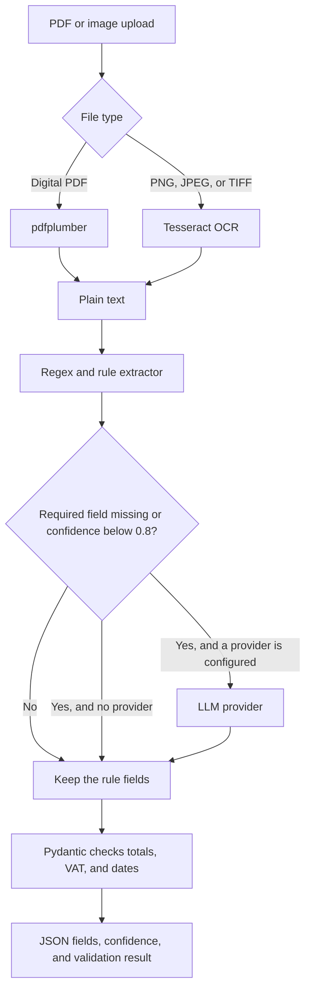

# Document AI Extractor

[](https://github.com/DatadrivenAlex/document-ai-extractor/actions/workflows/ci.yml)

Extract vendor, invoice number, dates, currency, totals, VAT, and line items from an invoice or a receipt.

**Author:** Alexandru Cojocari

The pipeline generates a seeded synthetic corpus with ground-truth JSON, reads digital PDFs with pdfplumber and images with Tesseract, applies a regex layer, and optionally fills gaps through a pluggable LLM provider. Pydantic checks that the total equals the sum of the lines plus VAT and that the dates are sane. A scoring command measures per-field accuracy against the ground truth. No paid API key is required.

## Pipeline



## Quickstart

```bash
python3 -m venv .venv
source .venv/bin/activate
pip install -e ".[dev]"
make test
document-ai generate --seed 42 --count 4 --out data/samples
document-ai extract data/samples/invoice_001.pdf --no-raw-text
document-ai extract data/samples/invoice_004.pdf --llm mock --no-raw-text
```

Layouts rotate with the document index, independent of the random seed: `invoice_001.pdf` is labeled, `invoice_002.pdf` is a table, `receipt_003.pdf` is a receipt, and `invoice_004.pdf` is prose. The prose file is the one the rule layer does not finish; `--llm mock` fills it offline.

Image OCR needs the Tesseract binary (`sudo apt-get install tesseract-ocr`). Without it, PDF extraction still runs, and the image tests skip.

Start the API:

```bash
document-ai serve
curl -s -F "file=@data/samples/invoice_001.pdf" http://127.0.0.1:8000/v1/extract | head
```

Interactive docs are at [http://127.0.0.1:8000/docs](http://127.0.0.1:8000/docs).

## Field accuracy

The table below is the `markdown` field of [`eval/baseline_report.json`](eval/baseline_report.json). It was produced by:

```bash
python -m document_ai evaluate --seed 42 --count 40 --out eval/baseline_report.json
```

`tests/test_baseline.py` runs that command again and fails if this table, or the JSON report, drifts.

Corpus: seed 42, 40 digital PDFs (10 labeled, 10 prose, 10 receipt, 10 table), text via pdfplumber. Rules only versus rules plus the deterministic mock provider.

| Field | Rules only | Rules + mock LLM |
| --- | --- | --- |
| Document type | 40/40 (100.0%) | 40/40 (100.0%) |
| Vendor | 30/40 (75.0%) | 40/40 (100.0%) |
| Invoice / receipt number | 40/40 (100.0%) | 40/40 (100.0%) |
| Issue date | 30/40 (75.0%) | 40/40 (100.0%) |
| Due date | 30/40 (75.0%) | 40/40 (100.0%) |
| Currency | 30/40 (75.0%) | 40/40 (100.0%) |
| Subtotal | 30/40 (75.0%) | 40/40 (100.0%) |
| VAT rate | 30/40 (75.0%) | 40/40 (100.0%) |
| VAT amount | 30/40 (75.0%) | 40/40 (100.0%) |
| Total | 30/40 (75.0%) | 40/40 (100.0%) |
| Line items | 30/40 (75.0%) | 40/40 (100.0%) |
| All field checks | 350/440 (79.5%) | 440/440 (100.0%) |
| Document exact match | 30/40 (75.0%) | 40/40 (100.0%) |
| Validation pass | 30/40 (75.0%) | 40/40 (100.0%) |

| Layout | Documents | Rules exact | Mock exact |
| --- | --- | --- | --- |
| labeled | 10 | 10/10 (100.0%) | 10/10 (100.0%) |
| prose | 10 | 0/10 (0.0%) | 10/10 (100.0%) |
| receipt | 10 | 10/10 (100.0%) | 10/10 (100.0%) |
| table | 10 | 10/10 (100.0%) | 10/10 (100.0%) |

These figures are exact-match scores on the synthetic corpus above. They are not a measurement on real vendor invoices. The prose layout is outside the rule grammar; the mock provider is a deterministic parser for that wording, not a neural model.

Rules score 30/40 because 10 of the 40 documents use the prose layout. On that layout the rules still recover the document type and the invoice number, and miss the vendor, dates, currency, amounts, and line items (90 field misses, all on prose). Labeled, table, and receipt documents are exact. The mock provider parses the prose wording and the merged result is exact on all 40 PDFs. That mock is a second deterministic parser, not a call to a model, so the 100% column is not an LLM benchmark.

## Example response

This is the API shape for one labeled synthetic invoice (`INV-2024-0099`, EUR, one line). The file was rendered to PDF and read back with pdfplumber. `raw_text` is omitted here; the CLI includes it unless `--no-raw-text` is set. Money is a string so it is not rounded through binary floats.

```json
{
  "document": {
    "document_type": "invoice",
    "vendor": "Danube Analytics",
    "document_number": "INV-2024-0099",
    "issue_date": "2024-04-03",
    "due_date": "2024-05-03",
    "currency": "EUR",
    "subtotal": "8.40",
    "vat_rate": "0.19",
    "vat_amount": "1.60",
    "total": "10.00",
    "line_items": [
      {
        "description": "Notebook",
        "quantity": "2",
        "unit_price": "4.20",
        "line_total": "8.40"
      }
    ]
  },
  "confidence": {
    "document_type": 0.97,
    "vendor": 0.95,
    "document_number": 0.96,
    "issue_date": 0.94,
    "due_date": 0.94,
    "currency": 0.95,
    "subtotal": 0.94,
    "vat_rate": 0.94,
    "vat_amount": 0.94,
    "total": 0.94,
    "line_items": 0.93
  },
  "field_sources": {
    "document_type": "rules",
    "vendor": "rules",
    "document_number": "rules",
    "issue_date": "rules",
    "due_date": "rules",
    "currency": "rules",
    "subtotal": "rules",
    "vat_rate": "rules",
    "vat_amount": "rules",
    "total": "rules",
    "line_items": "rules"
  },
  "overall_confidence": 0.9455,
  "validation_ok": true,
  "validation_errors": [],
  "warnings": [],
  "text_method": "pdfplumber",
  "extractor": "rules",
  "raw_text": null
}
```

Overall confidence is the mean of the eleven field scores. When validation fails, that mean is multiplied by 0.5. The weights are fixed heuristics: about 0.93 to 0.97 for a label match, 0.84 for a bare `INV-` or `RCT-` number, 0.74 for a value filled by the provider, and 0 for a missing field. They are not calibrated probabilities.

## Layout

```
document_ai/
  generator.py    seeded invoices and receipts, PDF + PNG + JSON
  render.py       text, reportlab PDF, Pillow PNG
  text.py         pdfplumber and pytesseract
  rules.py        labeled, table, and receipt grammars
  llm.py          provider interface, offline mock, optional HTTP provider
  pipeline.py     merge, confidence, validation
  evaluate.py     per-field accuracy
  api.py          FastAPI upload endpoint
  cli.py          generate, extract, evaluate, serve
tests/            offline pytest suite
eval/baseline_report.json
```

## CLI

| Command | What it does |
| --- | --- |
| `document-ai generate --seed 42 --count 8 --out data/samples` | Write PDFs, PNGs, and ground-truth JSON |
| `document-ai extract FILE [--llm none\|mock\|openai] [--no-raw-text]` | Print one extraction as JSON |
| `document-ai evaluate --seed 42 --count 40 --out eval/baseline_report.json` | Score a fresh corpus and write the report |
| `document-ai serve --host 127.0.0.1 --port 8000` | Run the HTTP API |

`make install`, `make test`, `make lint`, `make eval`, `make generate`, and `make serve` wrap the same commands.

## HTTP API

| Method | Path | Purpose |
| --- | --- | --- |
| `GET` | `/health` | Status plus whether the Tesseract binary is on `PATH` |
| `POST` | `/v1/extract` | Multipart field `file`. Query `llm` is `none` (default), `mock`, or `openai` |

Accepted types are PDF, PNG, JPEG, TIFF, and WEBP, up to 10 MB. An image upload returns 422 when Tesseract is not installed. `llm=openai` returns 400 when `OPENAI_API_KEY` is unset. A document that fails validation still returns 200; `validation_ok` is false and `validation_errors` lists the problems.

## Validation

A document passes when all of these hold:

- every line total equals quantity times unit price, within 0.01
- subtotal equals the sum of the line totals, within 0.01
- VAT amount equals subtotal times the VAT rate, within 0.01
- total equals subtotal plus VAT, within 0.01
- an invoice has a due date, and that date is not before the issue date
- both dates, when present, fall in 1990 through 2100

Receipts are allowed to omit a due date. The window is a fixed sanity check, not "today plus a few days", so the seeded corpus does not change overnight.

## LLM fallback

The provider interface is `extract(text) -> dict`.

- `none` uses rules only.
- `mock` is deterministic and offline. It understands the prose layout (`This invoice was issued by ...`) and otherwise repeats the rule parse. Tests and the accuracy table use this provider. It does not open a socket.
- `openai` calls a chat-completions endpoint. Set `OPENAI_API_KEY`, and optionally `OPENAI_BASE_URL` (default `https://api.openai.com/v1`), `OPENAI_MODEL` (default `gpt-4o-mini`), and `OPENAI_TIMEOUT`. Any OpenAI-compatible base URL works. If the request fails, the rule result is kept and the error is added to `warnings`.

Rule fields at confidence 0.8 or above are not overwritten. The mock writes 0.74, so it only fills gaps.

## Runbook

**Regenerate the published numbers.** Run `make eval`. Copy the `markdown` string from `eval/baseline_report.json` into this README. `tests/test_baseline.py` checks that a fresh seed-42, 40-document run equals the committed JSON and that this README still contains that markdown. Do not type the percentages by hand.

**A structured document fails validation.** Open the ground-truth JSON beside the PDF. Re-extract with the raw text left on, and compare it to `render_text` for that layout. Amount bugs are usually a thousands separator: EUR in this corpus is `1.234,56`, USD and GBP are `1,234.56`.

**Add a layout.** Add a branch in `document_ai/render.py`, emit it from `document_ai/generator.py` (the `LAYOUTS` cycle), and either extend `document_ai/rules.py` or teach `extract_prose` in `document_ai/llm.py`. Add a round-trip test that builds a `ValidatedDocument`, renders a PDF, and checks the fields. Then regenerate the baseline.

**Point the fallback at a local model.**

```bash
export OPENAI_API_KEY=sk-local
export OPENAI_BASE_URL=http://127.0.0.1:11434/v1
export OPENAI_MODEL=llama3.1
document-ai extract data/samples/invoice_004.pdf --llm openai
```

The test suite blocks outbound sockets, so this path is not exercised against a live server.

**Docker.** The image is `python:3.12-slim` plus `tesseract-ocr` and DejaVu fonts, and it listens on port 8000 as a non-root user.

```bash
docker build -t document-ai-extractor .
docker run --rm -p 8000:8000 document-ai-extractor
```

**CI is red.** The workflow in `.github/workflows/ci.yml` installs Tesseract, then runs `ruff check`, `ruff format --check`, and `pytest`. A baseline mismatch means the extractor output changed: inspect `failures` in a fresh report before updating the committed JSON. An OCR failure usually means the PNG font is not DejaVu; the renderer looks for `/usr/share/fonts/truetype/dejavu/DejaVuSans.ttf`.

**Tesseract is missing.** PDF routes keep working. `extract` on a PNG exits with an error, and `POST /v1/extract` returns 422. Tests marked with `tesseract binary is not installed` are skipped. CI installs the binary so the OCR test runs there.

## Limitations

- The scored corpus is synthetic. The rule layer is written for three label styles this generator emits. A real vendor PDF with a different layout will miss fields; the accuracy table is not a claim about production invoices.
- The mock provider is a deterministic parser for one prose template. It shows how a fallback plugs in. It does not measure a neural model.
- The optional HTTP provider is not called in CI. There is no key in the repository, and the tests refuse to open a network connection.
- OCR is implemented and covered when Tesseract is installed, but the published accuracy table uses digital PDFs only. Phone photos, skew, stamps, and handwriting are not measured.
- Labels are English. Each document has one currency. There is no multi-page table logic, no discounts, no withholding tax, and no payment-detail matching.
- EUR amounts use European grouping. USD and GBP use US grouping, including GBP, which often matches UK practice and is a deliberate corpus choice.
- Validation tolerance is one cent. A wrong vendor can still pass validation. Confidence scores are hand-set weights.
- The API has no authentication, persistence, or queue. Uploads are written to a temporary file and deleted after the request.
- Dates outside 1990–2100 are rejected even if the rest of the document is consistent.

## License

MIT. See [LICENSE](LICENSE). Copyright (c) 2026 Alexandru Cojocari.
